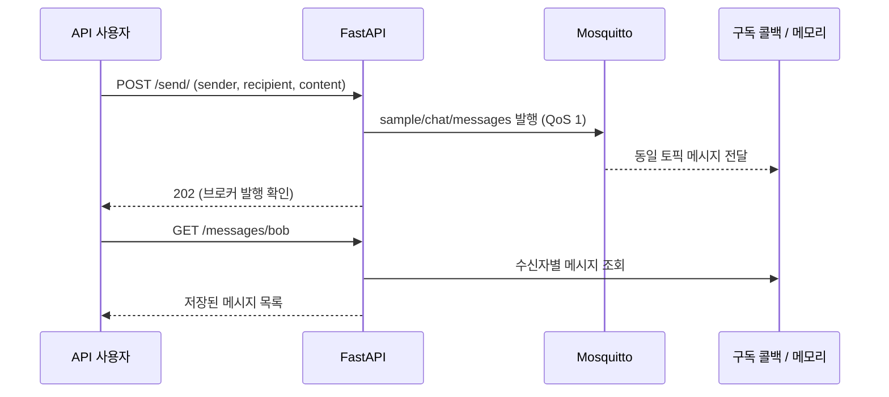

# FastAPI + MQTT 학습 샘플

2024년에 작성한 MQTT 채팅 연동 학습 코드를 2026년 공개용으로 정리한 저장소입니다.
FastAPI에서 받은 메시지를 Mosquitto에 발행하고, 구독 콜백에서 수신한 메시지를 HTTP API로 조회합니다.
상용 채팅 서버나 드론 관제 시스템 구현물이 아닙니다.

## 데이터 흐름



202 응답은 수신자의 읽음이나 저장 완료를 보장하지 않습니다. 구독 처리가 비동기이므로 조회에 반영되기까지 잠시 걸릴 수 있습니다.

## 구현 범위와 공개용 변경

원본 학습 코드에는 FastAPI, paho-mqtt, Mosquitto 연동과 Oracle 저장 시도가 포함되어 있었습니다.
공개본은 별도 DB 계정과 학교 프로젝트 테이블 없이 실행할 수 있도록 Oracle 의존성을 제거했습니다.

2026년 공개 준비 과정에서 AI 코딩 도구의 도움으로 다음을 보완했습니다.

- 발행/수신 메시지 형식을 `sender`, `recipient`, `content`로 통일
- 발행 토픽을 와일드카드가 없는 `sample/chat/messages`로 통일
- 수신 메시지 검증, 잘못된 JSON 무시, 연결 끊김 상태 처리
- 재접속 시 재구독 및 구독 확인 후 발행 허용
- 전체 최근 1,000건만 메모리에 보관하고 스레드 잠금으로 조회/저장 보호
- 로컬 전용 브로커 설정, 테스트, 실행 문서 추가

이 보완 사항은 2024년 당시의 구현 실적과 구분합니다.

## 실행 (Windows PowerShell / Python 3.12)

저장소 루트에서 실행합니다. 아래 의존성은 기존 학습 환경과 맞춘 버전이며 최신 버전 검증을 의미하지 않습니다.

```powershell
python -m venv .venv
.\.venv\Scripts\python.exe -m pip install -r requirements.txt
```

[공식 Mosquitto](https://mosquitto.org/download/)를 설치하고 별도 터미널에서 실행합니다.
기존 브로커가 1883 포트를 쓰고 있다면 동시에 실행할 수 없습니다.

```powershell
& 'C:\Program Files\mosquitto\mosquitto.exe' -c .\mosquitto.conf -v
```

다른 터미널에서 API를 실행합니다. 저장소 루트를 작업 디렉터리로 사용합니다.

```powershell
.\.venv\Scripts\python.exe -m uvicorn src.main:app --host 127.0.0.1 --port 8000
```

- Swagger UI: http://127.0.0.1:8000/docs
- 브로커 준비 상태: http://127.0.0.1:8000/health (`mqtt_ready: true` 확인)

```powershell
$message = @{sender='alice'; recipient='bob'; content='Hello MQTT'} | ConvertTo-Json
Invoke-RestMethod -Uri http://127.0.0.1:8000/send/ -Method Post -ContentType 'application/json' -Body $message
Invoke-RestMethod -Uri http://127.0.0.1:8000/messages/bob
```

조회 결과가 비어 있다면 잠시 후 다시 조회합니다. 브로커가 준비되지 않으면 발행 API는 503을 반환합니다.

## 테스트

```powershell
.\.venv\Scripts\python.exe -m unittest discover -s tests -v
```

단위 테스트는 실제 브로커 없이 수신자 분리, 잘못된 메시지 처리, 토픽 검사, 연결 실패, 저장 한도를 검증합니다.
실제 Mosquitto 연동은 위 실행 절차로 별도 확인합니다.

## 제한사항

- 로컬 학습 전용: API 인증, 사용자 인증 및 채팅방 권한 검사가 없습니다. `sender`는 클라이언트가 입력한 값입니다.
- 브로커 설정은 loopback 주소의 익명 접속만 허용합니다. 이 설정으로 외부 서비스를 운영하지 않습니다.
- 메시지는 프로세스 재시작 시 사라집니다. 여러 worker로 실행하면 저장소가 나뉘므로 단일 worker만 사용합니다.
- QoS 1 중복 수신에 대한 중복 제거, 오프라인 전달, 영구 저장은 구현하지 않았습니다.
- 이 저장소에는 실제 사용자 데이터, DB 자격증명, 기존 Git 이력을 포함하지 않습니다.

## 참고

- [Paho Python 문서](https://eclipse.dev/paho/clients/python/docs/) (현재 코드는 기존 1.6.1 콜백 API 사용)
- [Mosquitto 인증 설정](https://mosquitto.org/documentation/authentication-methods/)
- 원본 README의 설치 참고: https://pros2.tistory.com/137
